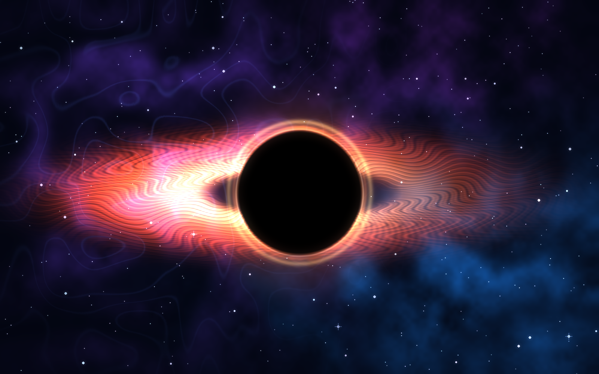
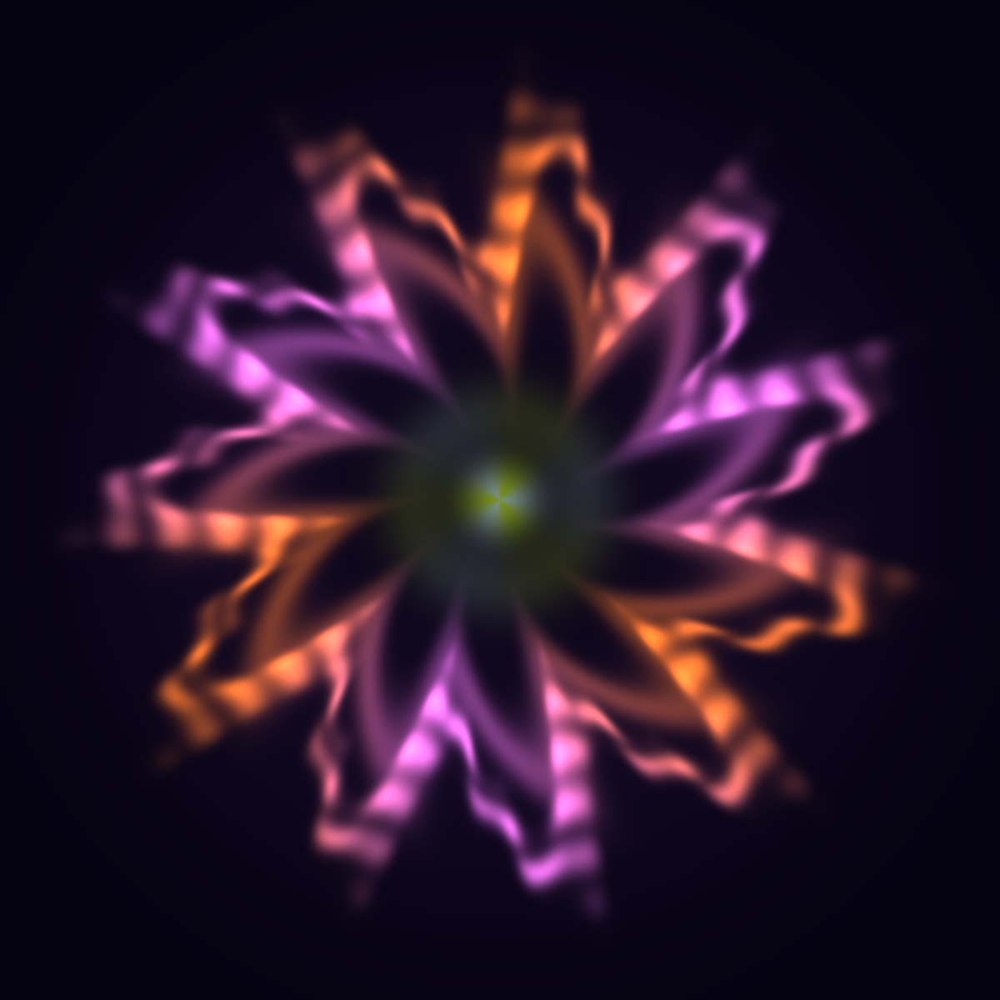

# HORIZON — Mathematical Black Hole Art

**An original algorithmic space illustration rendered from mathematical equations in Python — no generative AI, downloaded imagery, or 3D modeling.**



### Bonus: edit the mathematics yourself



Open **`my_formula.py`**, replace the equations defining `red`, `green`, and `blue` (or change the petal function), save, then run:

```bash
python render_my_formula.py
```

This makes `my_formula.png` directly from **your** formulas. No AI rendering.

On Windows, you can also double-click `RUN_WINDOWS.bat` to install dependencies and generate both examples.

## Quick start

You need Python 3.10+.

```bash
pip install -r requirements.txt
python generate.py
```

The script creates `horizon.png` in the current directory.

Custom resolution and reproducible seed:

```bash
python generate.py --width 1920 --height 1080 --seed 42 --output my_art.png
```

## How it works

Each pixel's RGB channels are calculated from continuous mathematical functions, before the final result is encoded as PNG.

- **Coordinate mapping:** screen positions become normalized `(x, y)` coordinates.
- **Accretion disk:** elliptical radius `r = sqrt(x² + (y/0.265)²)`; Gaussian radial profiles generate luminous rings.
- **Filaments:** terms such as `sin(58θ − 25r + 9 sin(6θ + 8r))` produce swirls.
- **Photon-ring-inspired arcs:** `exp(-((sqrt(x²+y²) − 0.448)/0.019)²)` models a thin circular glow.
- **Shadow:** a smooth mask leaves the central region dark.
- **Space clouds and stars:** seeded lattice noise, trigonometric curves, and randomly placed point lights generate the surroundings.

The full space-scene source is in [`generate.py`](generate.py); the editable formula canvas is in [`my_formula.py`](my_formula.py) and [`render_my_formula.py`](render_my_formula.py). Using the same seed, library versions, and dimensions reproduces the artwork. Randomness is used only as an input to the generator, not to select existing images.

> **Accuracy note:** This is artistic procedural visualization, **not** a scientific ray-tracing simulation of general relativity. Its accretion disk and gravitational-lensing-like rings are aesthetic approximations.

## Tools

Python · NumPy · Pillow · Procedural graphics · Trigonometry · Gaussian functions

## License

MIT — see [`LICENSE`](LICENSE).
